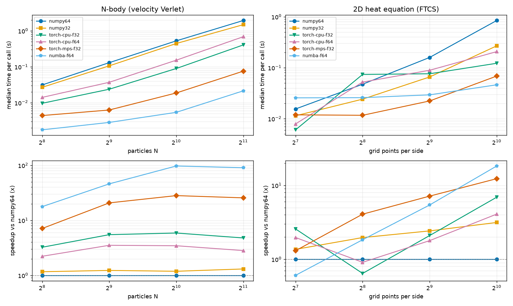

# numbench: scientific-kernel validation and benchmarking across CPU and GPU backends

`numbench` answers a question that comes up whenever a scientific code is moved towards a GPU
cluster: **does the fast version still compute the right numbers, where does the time go, and how
do I hand it to colleagues as a service?**

It implements two classic kernels (an O(N^2) gravitational N-body integrator and a 2D heat-equation
finite-difference solver) on interchangeable backends, tests every backend against a float64 NumPy
reference with explicit tolerances and physical checks, profiles and benchmarks them, pins the
environment, and wraps the whole thing in a FastAPI job-submission service that can run locally or
through SLURM.

Tested on an Apple M2 Pro (10 cores, 16 GB, macOS, Python 3.12). **There is no CUDA on this
machine: the CUDA and CuPy code paths are written but were not executed.** Everything quoted below
(tables, plot, profiles, test counts) comes from real runs on this Mac; see
[What was not executed here](#what-was-not-executed-here).

## Real-world use

1. **Port with confidence.** Before a kernel is moved to a GPU node, run it through the same accuracy
   suite on every backend. A speedup that changes the answer beyond a justified tolerance is a bug,
   so every benchmark row also carries its error against the float64 reference.
2. **Know where the time goes.** cProfile and `torch.profiler` wrappers show whether a kernel is
   dominated by arithmetic, memory traffic, Python dispatch or host/device transfers, which decides
   whether a GPU port will pay off.
3. **Give scientists an API instead of a shell recipe.** `POST /jobs` with a validated spec,
   poll the status, download CSV/JSON. Each run keeps a manifest (inputs, git commit, environment
   hash), so a number found six months ago can be reproduced.

## Architecture

```
                 +--------------------- numbench.api (FastAPI) ---------------------+
 client -------> | POST /jobs   GET /jobs/{id}   GET /jobs/{id}/result|manifest      |
                 +-------------------------------+-----------------------------------+
                                                 | JobStore: runs/<id>/{spec,manifest,status,result}
                              +------------------+------------------+
                              v                                     v
                   LocalThreadExecutor                       SlurmExecutor
                   (1 worker thread)               writes job.sbatch, sbatch / squeue
                              |                                     |
                              +------------------+------------------+
                                                 v
                                      numbench.runner (run_job)
                                                 v
        numbench.bench ----> backend registry: numpy64 numpy32 torch-{cpu,mps,cuda}-{f32,f64}
        numbench.profile      cupy-{f32,f64} (optional)  numba-f64 (optional)
                                                 v
                      kernels: nbody_accel / nbody_simulate (velocity Verlet) / heat_solve (FTCS)
                      reference: problems.py (float64 ICs, energy, analytic Gaussian solution)
```

* `numbench/backends/base.py`: the `Backend` interface, registry, and the backend-agnostic loops
  (`verlet`, `heat_ftcs`) that use only operators NumPy, CuPy and PyTorch share, so those backends
  run literally the same numerical code.
* A backend takes float64 host arrays and returns float64 host arrays, so timings are end to end
  (host to device, compute, device to host) and every backend is compared on the same contract.
* `torch-auto-f32` resolves to cuda, then mps, then cpu at run time.
* Unavailable backends stay registered with a **reason** (for example "torch.cuda.is_available() is
  False"), which is what the tests report when they skip.

## Numerical-accuracy methodology

Every backend is compared against `numpy64` (float64, vectorised NumPy) with

```
|actual - ref| <= atol_scale * max|ref| + rtol * |ref|        (elementwise)
```

| dtype | rtol | atol_scale | multi-step factor |
|---|---|---|---|
| float64 | 1e-10 | 1e-12 | x100 |
| float32 | 1e-4 | 1e-5 | x10 |

**Why float32 is looser.** float32 has unit roundoff about 6e-8 (float64: about 1.1e-16); summing N
force terms accumulates roughly sqrt(N) roundings and the inputs are rounded on the cast. **Why the
absolute part scales with `max|ref|`:** forces and temperatures contain near-zero entries produced
by cancellation, and a purely relative test would measure the rounding of the terms against a tiny
result. The tolerances are deliberately a little above what is observed (below) but far below any
algorithmic mistake; a test also asserts that a float32 result *fails* the float64 bar, so the two
numbers are not arbitrary.

Observed errors on this machine, as `max|a - ref| / max|ref|` (from the benchmark CSV, after 3 to
200 steps, all sizes):

| backend | worst observed error | tolerance used (multi-step) |
|---|---|---|
| numpy32, torch-cpu-f32, torch-mps-f32 | 4.6e-7 | 1e-4 (atol_scale) |
| torch-cpu-f64 | 5.6e-17 | 1e-10 (atol_scale) |
| numba-f64 | 2.8e-17 | 1e-10 (atol_scale) |

Single force evaluations (N=256) show the same picture: 3.3e-7 to 3.8e-7 for float32 backends
(tolerance 1e-5), 8e-16 or below for float64 backends (tolerance 1e-12).

Physics checks (all backends, `tests/test_physics.py`):

* **Energy conservation.** Velocity Verlet with the Plummer-softened potential conserves
  E = KE + PE; after 200 steps (about one crossing time) the drift is about 5e-7 (limits: 1e-4
  float64, 5e-4 float32). A separate test checks the integrator is **second order**: halving dt
  reduces the energy fluctuation by about 4x.
* **Momentum** is conserved to rounding (pairwise forces are equal and opposite), and a two-body
  force is checked against its closed form.
* **Heat equation vs the analytic solution.** A Gaussian spreads as
  `u = s0^2/(s0^2 + 2at) * exp(-r^2 / (2 (s0^2 + 2at)))`; the Gaussian stays about 10 sigma from the
  boundary, so the Dirichlet box matches free space far better than the discretisation error.
* **Convergence.** At fixed r = alpha dt/dx^2 = 0.2 the max error is 8.4e-3, 2.0e-3 and 5.0e-4 for
  33, 65 and 129 grid points, i.e. observed order 2.04 and 2.02 (asserted to lie in 1.7 to 2.3).
  The discrete maximum principle, mass conservation, the Dirichlet boundary, and the instability at
  r = 0.3 (stability limit 0.25) are tested too.
* Zero softening is rejected up front: the self-interaction would evaluate 0 x inf = NaN (a real
  bug the test suite caught while it was written).

## Benchmark results (real run, Apple M2 Pro)

`python -m numbench.bench --out results` (7 repeats after 2 warm-ups; N-body: 10 Verlet steps;
heat: 200 FTCS steps). Cells are **median ms (±IQR) / speedup over numpy64**.
Raw data: [`results/benchmark.csv`](results/benchmark.csv).



**N-body** (rows: particles N)

| backend | 256 | 512 | 1024 | 2048 |
|---|---:|---:|---:|---:|
| numpy64 | 31.2 (±0.9) / 1.0x | 130.1 (±2.4) / 1.0x | 525.5 (±16.6) / 1.0x | 1,935.0 (±43.2) / 1.0x |
| numpy32 | 26.8 (±0.6) / 1.2x | 106.0 (±2.0) / 1.2x | 443.3 (±10.6) / 1.2x | 1,482.7 (±19.4) / 1.3x |
| torch-cpu-f32 | 9.6 (±0.8) / 3.2x | 23.7 (±0.6) / 5.5x | 89.4 (±4.6) / 5.9x | 404.8 (±10.8) / 4.8x |
| torch-cpu-f64 | 14.1 (±0.5) / 2.2x | 37.0 (±1.4) / 3.5x | 152.3 (±3.9) / 3.5x | 686.5 (±8.7) / 2.8x |
| torch-mps-f32 | 4.4 (±0.3) / 7.1x | 6.3 (±0.5) / 20.7x | 18.7 (±0.4) / 28.1x | 75.5 (±0.1) / 25.6x |
| numba-f64 | 1.8 (±0.0) / 17.7x | 2.8 (±0.1) / 46.0x | 5.4 (±0.1) / 97.2x | 21.4 (±0.4) / 90.4x |

**2D heat equation** (columns: grid points per side)

| backend | 128 | 256 | 512 | 1024 |
|---|---:|---:|---:|---:|
| numpy64 | 15.5 (±1.6) / 1.0x | 47.4 (±1.9) / 1.0x | 159.0 (±4.5) / 1.0x | 843.1 (±37.9) / 1.0x |
| numpy32 | 11.4 (±2.8) / 1.4x | 24.2 (±4.4) / 2.0x | 65.8 (±1.3) / 2.4x | 268.2 (±5.7) / 3.1x |
| torch-cpu-f32 | 6.0 (±0.1) / 2.6x | 73.8 (±51.6) / 0.6x | 76.0 (±4.0) / 2.1x | 122.1 (±9.9) / 6.9x |
| torch-cpu-f64 | 7.9 (±0.1) / 2.0x | 52.2 (±17.5) / 0.9x | 89.1 (±6.1) / 1.8x | 206.7 (±9.5) / 4.1x |
| torch-mps-f32 | 11.9 (±1.1) / 1.3x | 11.7 (±0.1) / 4.1x | 22.3 (±1.3) / 7.1x | 68.6 (±0.2) / 12.3x |
| numba-f64 | 25.6 (±3.0) / 0.6x | 25.8 (±0.3) / 1.8x | 29.3 (±2.0) / 5.4x | 46.2 (±2.3) / 18.3x |

Reading the tables honestly:

* Backends differ in precision (the `numba-f64` and `torch-cpu-f64` rows are float64, the `-f32` rows
  are float32, and Apple MPS has no float64), so speedups are not all like-for-like. Compare f64
  with f64 and f32 with f32 when judging an implementation.
* Run-to-run noise is real: numpy64 heat at 512 took 210 ms in an earlier full run and 159 ms in
  this one, so treat differences under about 1.3x as noise. The N-body numbers were stable.
* The N-body formulation here is the simple vectorised one that builds N x N x 3 temporaries. That
  is why `numba-f64`, whose fused loop never builds them, wins by roughly 90x at N=2048 and beats the
  GPU. A fused or tiled GPU kernel (hand-written, `torch.compile`, or a CuPy `ElementwiseKernel`) is
  the proper GPU implementation and **was not written**; the MPS row measures the naive tensor
  formulation plus upload/download.
* Peak memory (tracemalloc, NumPy only): N-body N=2048 peaks at 256 MiB in float64 and 128 MiB in
  float32, about 2.7 times the 96 MiB `diff` tensor, which is the memory wall of this formulation.
  Heat 1024: 24 MiB / 12 MiB. Torch CPU, Numba and MPS memory is reported as unavailable in the CSV
  (`nan`, `mem_source=unavailable`) because there is no honest per-case peak counter for them;
  CUDA backends would report `torch.cuda.max_memory_allocated`.

## Profiling findings

Commands: `python -m numbench.profile --kernel nbody --backend numpy64 --size 1024` and the same
with `--torch`. Raw outputs are in [`results/profile_*.txt`](results).

1. **N-body is memory-traffic bound, not arithmetic bound.** `torch.profiler` for torch-cpu-f32
   at N=1024 (10 steps): `mul` 29%, `pow` 27%, `sub` 22%, `sum` 16% of CPU time, with `mul` alone
   allocating 308 MB across 74 calls. Every operation streams an N x N (x3) array through memory.
   cProfile of numpy64 agrees: 67% of time is inside `accel_xp` itself (the elementwise ufuncs, which
   cProfile cannot split further), 32% in the `sum` reductions. Python overhead is negligible.
2. **Heat equation on small grids is Python/dispatch bound.** At 128 x 128 the whole 200-step solve
   takes about 6 to 15 ms, which is tens of microseconds per step for about 15 tiny array
   operations; the torch profile (`results/profile_torch_heat_torch-mps-f32_512.txt`) shows 2000 `slice` calls
   and hundreds of `add_`/`mul` calls costing 0.5 to 3 microseconds each. This is why neither MPS nor Numba helps at 128 (they are 1.3x and 0.6x), and it
   is the argument for fusing the stencil into one kernel.
3. **Default PyTorch threading hurts mid-sized stencils.** torch-cpu-f32 heat at 256 x 256 took 71 to
   87 ms with the default 10 intra-op threads but 14 ms with one. Reproduce with
   `--torch-threads 1` (data: [`results/heat_torch_cpu_threads.csv`](results/heat_torch_cpu_threads.csv)):

| torch threads | 128 | 256 | 512 | 1024 |
|---|---:|---:|---:|---:|
| 1 | 5.8 | 14.0 | 47.3 | 183.6 |
| 10 | 6.2 | 86.8 | 94.5 | 122.5 |

   With the default thread count, the small strided slices spend their time synchronising threads;
   at 1024 the threads finally pay off. I measured the effect but did not isolate its exact cause
   (thread wake-up versus strided access), so that part is an inference.
4. **Reading a GPU profile.** The torch.profiler run on MPS (`results/profile_torch_heat_torch-mps-f32_512.txt`)
   attributes 86% of CPU time to `aten::copy_`. That is the final `.cpu()` blocking until the
   asynchronously launched kernels finish, i.e. the GPU compute time shows up as a wait in the host
   profile. Per-kernel GPU time needs the CUDA profiler activity (`ProfilerActivity.CUDA`, enabled
   automatically by `numbench.profile` when a CUDA device is used) or Metal System Trace.

## Quick start

```bash
python3.12 -m venv .venv && source .venv/bin/activate
pip install -e ".[numba,dev]"         # or: pip install -r requirements.lock.txt && pip install -e .
pytest -q                              # accuracy, physics, benchmark, API, SLURM tests
python -m numbench.bench --out results # full benchmark: CSV + plot (about 2 minutes here)
python -m numbench.bench --quick       # tiny sizes for smoke runs / CI
python -m numbench.profile --kernel nbody --backend torch-cpu-f32 --size 1024 --torch
uvicorn --factory numbench.api:create_app   # job service on :8000, docs at /docs
```

Job API example:

```bash
curl -s -XPOST localhost:8000/jobs -H 'content-type: application/json' \
  -d '{"kernel":"nbody","backends":["torch-mps-f32","numba-f64"],"sizes":[256,512],"steps":10}'
# {"job_id":"5447a7e651d0","state":"queued","status_url":"/jobs/5447a7e651d0"}
curl -s localhost:8000/jobs/5447a7e651d0                       # state: queued|running|done|failed, progress
curl -s "localhost:8000/jobs/5447a7e651d0/result?format=csv"   # 409 until done
curl -s localhost:8000/jobs/5447a7e651d0/manifest              # inputs, git commit, env hash
```

`kind: "simulation"` runs one backend at one size and returns physical diagnostics (energy drift,
momentum, error against the float64 reference for N-body; L-infinity/L2 error against the analytic
solution for the heat equation). Specs are validated by pydantic (known backends, size limits,
unknown fields rejected); unavailable backends are refused with their reason (HTTP 422).

Reproducibility: every run directory holds `spec.json`, `manifest.json` (inputs, git commit and dirty
flag, SHA-256 of the installed package set, Python/platform, key package versions), `status.json` and
the results. Versions are pinned in `pyproject.toml`, `requirements.lock.txt` (pip freeze) and
`environment.yml`.

## Running on SLURM and CUDA

```bash
export NUMBENCH_EXECUTOR=slurm NUMBENCH_RUNS_DIR=/shared/numbench/runs   # shared filesystem
export NUMBENCH_SLURM_PARTITION=gpu NUMBENCH_SLURM_GPUS=1 NUMBENCH_SLURM_TIME=00:30:00
uvicorn --factory numbench.api:create_app --host 0.0.0.0 --port 8000
```

`SlurmExecutor` writes `job.sbatch` into the run directory (job name, time, cpus, memory,
optional `--partition` and `--gres=gpu:N`, `OMP_NUM_THREADS`, optional setup lines such as
`module load cuda`), calls `sbatch --parsable`, and records the SLURM id. The compute node runs
`python -m numbench.runner <run_dir>`, which updates `status.json` on the shared filesystem. On each
status request `squeue` is polled: states such as TIMEOUT, CANCELLED, OOM, NODE_FAIL mark the job
failed, and a job that vanished from the queue without writing a result is reported as failed rather
than left "running" forever. The python used on the node is `SlurmConfig.python` (set it to the
cluster venv). On a GPU host:

```bash
pip install -e ".[numba,cupy,dev]"        # cupy-cuda12x
pytest -q                                  # torch-cuda-* and cupy-* cases un-skip automatically
python -m numbench.bench --backends numpy64 torch-cuda-f32 torch-cuda-f64 cupy-f32 cupy-f64 --out results-gpu
docker build -f Dockerfile.gpu -t numbench-gpu . && docker run --gpus all -p 8000:8000 numbench-gpu
```

## Layout

```
numbench/  backends/ (base, array_backend[numpy+cupy], torch_backend, numba_backend)  problems.py
           tolerances.py  bench.py  profile.py  jobs.py  executors.py  runner.py  api.py  manifest.py
tests/     accuracy, physics, bench/profile, API (local + fake-sbatch end to end), SLURM executor
results/   benchmark.csv, speedup.png, profile_*.txt, heat_torch_cpu_threads.csv  (from the real run)
Dockerfile.cpu  Dockerfile.gpu (untested)  environment.yml  requirements.lock.txt  pyproject.toml
ci/github-actions-ci.yml   workflow: ruff + pytest + tiny benchmark uploaded as an artifact
                           (install it as .github/workflows/ci.yml, see the note below)
```

## What was not executed here

* **No CUDA anywhere.** `torch-cuda-*` and `cupy-*` are registered and written against the standard
  `torch.cuda` / CuPy APIs (including `Stream.null.synchronize()` and `cuda.max_memory_allocated`
  hooks), but they never ran: their tests **skip with an explicit reason** and I have no CUDA numbers.
  CPU and Apple MPS results are real; CUDA results are not claimed.
* `Dockerfile.gpu` was not built (no NVIDIA host). `Dockerfile.cpu` was not built either (the Docker
  daemon was not running during development). **CI has not run**: the workflow lives in `ci/github-actions-ci.yml` because the GitHub token
  used to publish this repository lacked the `workflow` scope, so it could not be pushed to
  `.github/workflows/`. To enable it: `gh auth refresh -s workflow`, then
  `mkdir -p .github/workflows && git mv ci/github-actions-ci.yml .github/workflows/ci.yml`. It
  runs ruff, pytest and `python -m numbench.bench --quick`, and uploads the CSV as an artifact.
* The SLURM executor was tested against **fake `sbatch`/`squeue` executables**, including an end to
  end API run where the fake sbatch executes the generated script, not against a real SLURM cluster.
  Real-cluster details (accounts, QoS, module names, `sacct`-based accounting) will need site tuning.
* No fused GPU kernels, multi-GPU, multi-node (MPI) or mixed-precision accumulation were implemented.
  MPS has no float64, so there is no f64 GPU comparison on this machine.
* Timings are from a single machine, a single run, on a laptop-class chip with default OS scheduling.

## License

MIT
